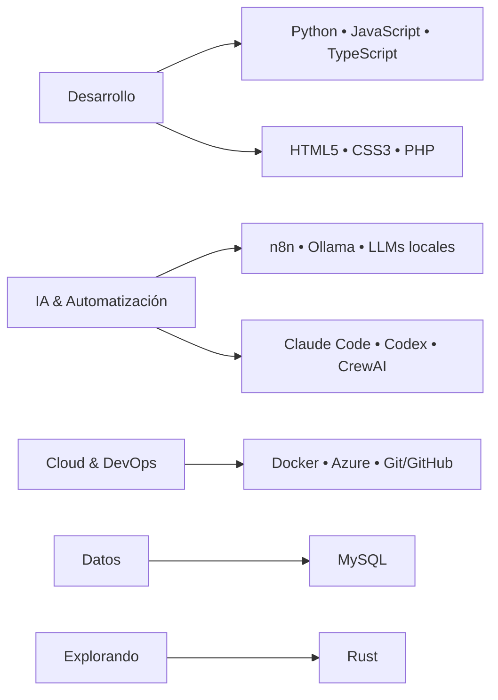

---

## 🌟 Hola, soy Sam 👋

> *"Construyo puentes entre la tecnología, la humanidad y lo divino."*

Desarrollador enfocado en **IA aplicada y automatización**. Soy **Junior Consultant de IA y Desarrollo en RSM Colombia**, donde diseño agentes de IA, flujos automatizados y herramientas internas para procesos de consultoría. En paralelo, cofundé **Kuisi Studios**, un equipo de desarrollo a la medida, y construyo productos propios con LLMs locales y en la nube.

✨ **Lo que me define:**
- 🎯 **Enfoque:** agentes de IA, automatización con n8n y Ollama, y desarrollo de producto propio
- 🕊️ **Propósito:** servir con excelencia técnica y claridad espiritual en cada proyecto
- 🌱 **Crecimiento:** aprendizaje continuo con base en la fe y la disciplina

---

## 💻 Stack Tecnológico

| Categoría | Tecnologías |
|-----------|-------------|
| **Backend** |   |
| **Frontend** |      |
| **IA & Automatización** |    |
| **Cloud & Tools** |    |
| **Bases de datos** |  |

---

## 🚀 Proyectos Destacados

| Proyecto | Descripción | Tecnologías | Estado |
|----------|-------------|-------------|--------|
| **[CATA](https://github.com/Soysamdval/CATA)** · [catagenerator.com](https://catagenerator.com) | SaaS que genera catálogos comerciales de forma automática | Python • n8n • Ollama • Docker | 🔄 En despliegue |
| **[Nexus](https://github.com/Soysamdval/NEXUS)** | Análisis estructural y exportación de datos | Python • Docker | ✅ Activo |
| **[KOINOIA](https://github.com/Soysamdval/KOINOIA)** | App móvil de finanzas personales inteligentes con enfoque cristocéntrico | — | 🌱 En desarrollo |
| **IA aplicada en consultoría** | Agentes de IA y automatizaciones para procesos de consultoría empresarial (código privado) | Python • LLMs • n8n | 💼 Profesional |

> 💡 *¿Tienes una idea? [Hablemos](mailto:sam.sanchez200703@gmail.com) sobre cómo materializarla.*

---

## 📊 Métricas & Actividad

---

## 🎓 Formación & Certificaciones

🎓 **Tecnólogo en Análisis y Desarrollo de Software** — SENA · Graduado 2026

| Certificación | Organización |
|--------------|-------------|
| CS50's Introduction to Computer Science | HarvardX |
| Fundamentos de nube y ciberseguridad en Microsoft Azure | U. de los Andes / Microsoft |
| Marketing Digital (48 h) | SENA |
| Negociación de Productos en Redes Sociales (48 h) | SENA |
| English Does Work – Level 5 (48 h) · Level 6 en curso | SENA |
| Diplomado en Participación Ciudadana y Control Social (120 h) | Personería de Bogotá / U. Distrital |

🔭 **En preparación:** Microsoft Certified — Azure AI Fundamentals (AI-900)

---

## 🤝 Reconocimientos

★ Reconocimiento de la Alcaldía Local de Ciudad Bolívar por su aporte al Consejo Consultivo Local de Niños, Niñas y Adolescentes (2023)
★ Participación en el proyecto "¡Qué Nota! La música, mi lugar seguro" — Fundación San Antonio

---

## 📫 Conectemos

| 💼 Profesional | 🎨 Creativo | ✉️ Contacto Directo |
|---------------|-------------|-------------------|
|  |  |  |

---

Hecho con <code>❤️</code>, <code>disciplina</code> y <code>fe</code> por <b>Sam D Val</b> 
<i>"No por la fuerza, ni por el poder, sino por mi Espíritu" — Zacarías 4:6</i>

